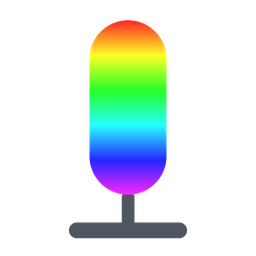
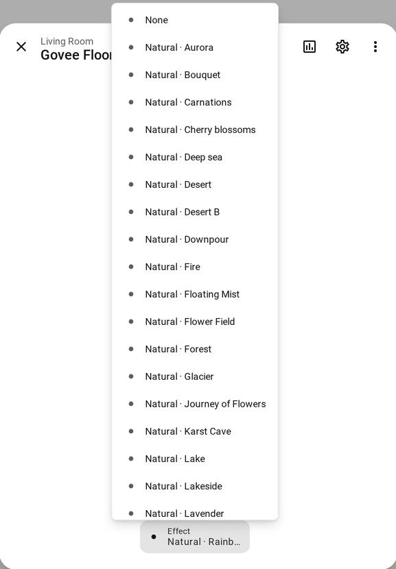

<p align="center">
  
</p>

<h1 align="center">Govee Local Scenes for Home Assistant</h1>

<p align="center">
  Every scene of the Govee Home app in the Effect menu of your lights, sent over your local network.
</p>

<p align="center">
  <a href="https://hacs.xyz"></a>
  <a href="https://github.com/casi-3/ha-govee-local-scenes/releases"></a>
  
  <a href="LICENSE"></a>
</p>

<p align="center">
  <a href="https://my.home-assistant.io/redirect/hacs_repository/?owner=casi-3&repository=ha-govee-local-scenes&category=integration"></a>
</p>

<p align="center">
  
</p>

## ✨ Highlights

- 🌈 **All the scenes**: the built-in Govee lights local integration only knows a handful of scenes per model. This version fills the Effect menu with the full scene catalog of your device, the same one the Govee Home app shows (108 scenes on a Floor Lamp Basic H6076).
- 🏠 **Local control**: scenes are sent straight to the light over the LAN API. No Govee account, no API key, no cloud round trip when you switch scenes.
- 🔁 **Drop-in replacement**: same domain, same config entry, same entities. Your automations, dashboards and entity ids stay as they are.
- 🧩 **Works with any model**: the catalog of the H6076 is bundled. For other models it is downloaded once from Govee's public scene library and kept on disk, after that everything stays local.
- 🧱 **No extra dependency**: it uses the same `govee-local-api` package as Home Assistant itself.

## 📦 Installation

> [!IMPORTANT]
> This integration **replaces** the built-in `govee_light_local` integration while it is installed. Home Assistant shows a warning about it in the logs, this is expected.

First enable **LAN Control** for your light in the Govee Home app (device settings).

### With HACS (recommended)

Click the button below, then **Download** and restart Home Assistant.

<a href="https://my.home-assistant.io/redirect/hacs_repository/?owner=casi-3&repository=ha-govee-local-scenes&category=integration"></a>

<details>
<summary>Without the button</summary>

1. In HACS, open the menu in the top right corner, then **Custom repositories**.
2. Add `https://github.com/casi-3/ha-govee-local-scenes` with the type **Integration**.
3. Install **Govee Local Scenes** and restart Home Assistant.

</details>

### Manually

1. Copy the `custom_components/govee_light_local` folder into the `custom_components` folder of your Home Assistant configuration.
2. Restart Home Assistant.

If you already use the built-in integration, there is nothing else to do: your lights come back with the new Effect list after the restart. Otherwise add **Govee lights local** from **Settings > Devices & services**.

## 🎨 Usage

<p align="center">
  
</p>

Open a light and pick a scene in the **Effect** menu. Scenes are named `Category · Name`, for example `Natural · Rainbow` or `Festival · Christmas`, and sorted by category.

In automations and scripts:

```yaml
action: light.turn_on
target:
  entity_id: light.floor_lamp
data:
  effect: "Natural · Rainbow"
```

Categories follow the language of your Home Assistant instance when a translation exists (French for now), English otherwise. If a scene name appears twice in the same category, the scene code is added in parentheses.

## ⚙️ How it works

Govee publishes the scene catalog of each model in a public library used by its app. Each scene comes with a code and, for animated scenes, a parameter block. The integration turns that into the `ptReal` packets the light understands and sends them over UDP to port 4003, exactly like the app does on the local network.

Catalogs are looked up in this order:

1. the catalogs bundled with the integration (`catalogs/<SKU>.json`)
2. the catalogs already downloaded (`.storage/govee_light_local_catalogs/`)
3. a single anonymous HTTPS request to Govee's scene library, saved for next time

If no catalog can be found, the light keeps the scenes of the built-in integration.

## 🚧 Limitations

- Tested on the Floor Lamp Basic (H6076). Other models with LAN control should work the same way, feedback is welcome.
- H60A6 firmware 1.00.41: the device-specific A3/A4 scene encoding matches a working BLE reference, but the tested LAN `ptReal` routes did not execute it. The encoding correction does not establish native LAN scene support for this model.
- Music mode and DIY scenes are not supported.
- The current scene is not read back from the light: if you change it in the Govee app, Home Assistant still shows the last scene it sent.
- This is a snapshot of the built-in integration from Home Assistant 2026.10. Updates to the built-in version are not applied automatically.

## 🗑️ Uninstall

Remove the integration from HACS (or delete `custom_components/govee_light_local`) and restart Home Assistant. The built-in integration takes over again with the same config entry.

## 🛠️ Troubleshooting

For detailed logs, add to `configuration.yaml`:

```yaml
logger:
  logs:
    custom_components.govee_light_local: debug
```

A problem or an idea? [Open an issue](https://github.com/casi-3/ha-govee-local-scenes/issues).

## 🙏 Credits

Developed by **casi-3 (casi3)**. Please keep this credit if you reuse or modify this work.

Based on the `govee_light_local` integration of [Home Assistant Core](https://github.com/home-assistant/core). The scene packet format follows the work done in [govee2mqtt](https://github.com/wez/govee2mqtt). See [NOTICE](NOTICE).

This project is not affiliated with Govee.

## 📜 License

[Apache 2.0](LICENSE)
